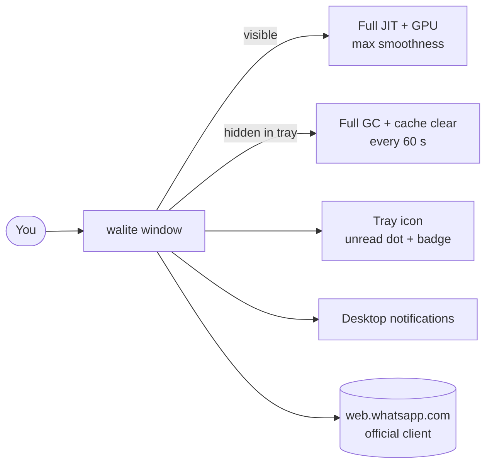

<div align="center">


**WhatsApp Web, minus the bloat.** Voice & video calls, lower RAM, no Python, no bundled browser, and no unofficial protocol hacks.

[](LICENSE)


Built by **[Yusif Ezizov · Azedev](https://azedev.com)**

</div>

---

## ✨ Why WhatRustApp?

Most Linux WhatsApp wrappers ship a full browser engine plus a scripting runtime and grow past **1 GB** of RAM. WhatRustApp keeps the official WhatsApp Web experience and cuts the overhead:

- 🧠 **About half the RAM** of a typical wrapper while you use it
- 📞 **Voice & video calls** work in the main app
- 🛡️ **No ban risk from unofficial clients.** It loads the official `web.whatsapp.com`; there is no reverse-engineered protocol and no automation
- ⚡ **Fast while visible, frugal while hidden.** Full JIT and GPU when you use it; memory is reclaimed only while it sits in the tray
- 🔔 Native desktop notifications. Clicking one brings the window up
- 🔴 Unread counter on the tray icon and as a badge
- 🪶 Tiny footprint: the main app is a few KB of JavaScript on your distro's shared Chromium runtime, and the lite app is a ~1.7 MB Rust binary

## 📊 Measured memory

Same account, 16 GB machine, PSS from `/proc/*/smaps_rollup`:

| Client | Calls | RAM, window in use | Long-running total (RAM + swap) |
|---|:---:|---|---|
| **WhatRustApp** `walite` (Chromium) | ✅ | **~680 MB** | not yet measured |
| **WhatRustApp Lite** `walite-lite` (Rust + WebKitGTK) | ❌ | **~470–700 MB** | not yet measured |
| ZapZap (Python + QtWebEngine) | ✅ | ~1250 MB average, 1740 MB peak | ~4.7 GB after 2 days (3.5 GB of it swapped) |

> Measurements are from one machine over a short period. Your numbers will vary with account size and chat history.

## 🧩 Two flavours

| | `walite` (main) | `walite-lite` |
|---|---|---|
| Engine | System Chromium (`electron41`) | System WebKitGTK 4.1, written in Rust |
| Voice / video calls | ✅ | ❌ (Arch's WebKitGTK is built without WebRTC) |
| Voice notes, media, notifications | ✅ | ✅ |
| Best for | Everyday use, calls | Messaging only, smallest footprint |

## 🚀 Install (Arch / CachyOS / Manjaro)

```bash
# main app runtime
sudo pacman -S electron41
# only needed for walite-lite
sudo pacman -S webkit2gtk-4.1 gtk3 rust

git clone https://github.com/Really-y/WhatRustApp.git
cd WhatRustApp
./install.sh            # installs walite + walite-lite into ~/.local
./install.sh --uninstall
```

Launch **WaLite** from your app menu, or run `walite`. Scan the QR code once with your phone (**WhatsApp → Linked devices → Link a device**).

## ⌨️ Usage

| Action | How |
|---|---|
| Hide to tray | Close the window. Messages keep arriving |
| Show / hide | Left-click the tray icon |
| Quit | Tray → **Quit**, or `Ctrl+Q` |
| Reload | `Ctrl+R` |
| Start hidden | `WALITE_HIDDEN=1 walite` |

### Environment variables

**`walite` (main)**
- `WALITE_HIDDEN=1`: start in the tray
- `WALITE_NO_GPU=1`: disable GPU acceleration (uses less RAM, scrolls less smoothly)

**`walite-lite`**
- `WALITE_MEM_LIMIT=<MB>`: web-process memory pressure limit (default `1200`)
- `WALITE_GPU=1`: enable GPU acceleration (about +200 MB)
- `WALITE_HIDDEN=1`, `WALITE_DEVTOOLS=1`, `WALITE_NO_BG_GC=1`, `WALITE_DEBUG=1`
- `JSC_useJIT=0`: lower background RAM (~440 MB) at the cost of UI speed

Data lives in `~/.local/share/walite-chromium` (main) and `~/.local/share/walite` / `~/.cache/walite` (lite).

## 🏗️ How it works



- **Main app** (`chromium-proto/`): a single renderer process with site-isolation extras and spare renderers turned off, unused Chromium features disabled, and a roomy V8 heap so the UI doesn't stall on GC. A preload script runs a full GC only while the page is hidden.
- **Lite app** (`src/`, `ext/`): GTK3 + WebKitGTK in Rust, with a document-viewer cache model, tuned memory-pressure thresholds and a pure-Rust StatusNotifier tray (`ksni`). A tiny WebKit web-process extension (`libwalite_ext.so`) forces a full JavaScriptCore GC while the window is hidden.

## 🛠️ Build from source

```bash
cargo build --release --workspace     # walite-lite + its WebKit extension
electron41 chromium-proto             # run the main app straight from the repo
```

## ⚠️ Disclaimer

WhatRustApp is an independent project. It is **not affiliated with, endorsed by, or sponsored by WhatsApp or Meta**. "WhatsApp" is a trademark of its respective owner. The app only displays the official WhatsApp Web site, and you are responsible for following WhatsApp's Terms of Service.

## 📜 License

**[GNU AGPL-3.0](https://www.gnu.org/licenses/agpl-3.0.html) with the [Commons Clause](https://commonsclause.com/) License Condition v1.0** © 2026 Yusif Ezizov · Azedev

- ✅ Use, study, share and modify it freely, keeping the copyright and **attribution** to Yusif Ezizov · Azedev
- 🔁 Modified versions, including ones offered over a network, must be released under the **same license, with source code**
- 🚫 **No selling.** You may not sell the software, or a paid product, hosting or support service whose value comes substantially from it

Because of the Commons Clause this is a *source-available* license, not an OSI "open source" one. See [LICENSE](LICENSE) for the full legal text. For commercial licensing, contact [Azedev](https://azedev.com).

---

<div align="center">

Made with 🦀 and ☕ by **[Azedev](https://azedev.com)**

</div>
